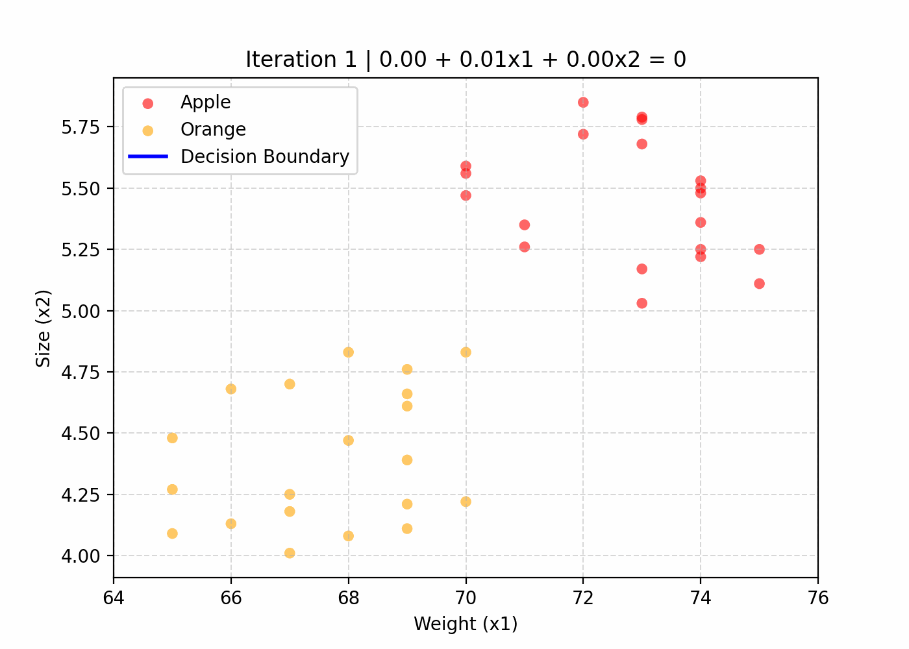
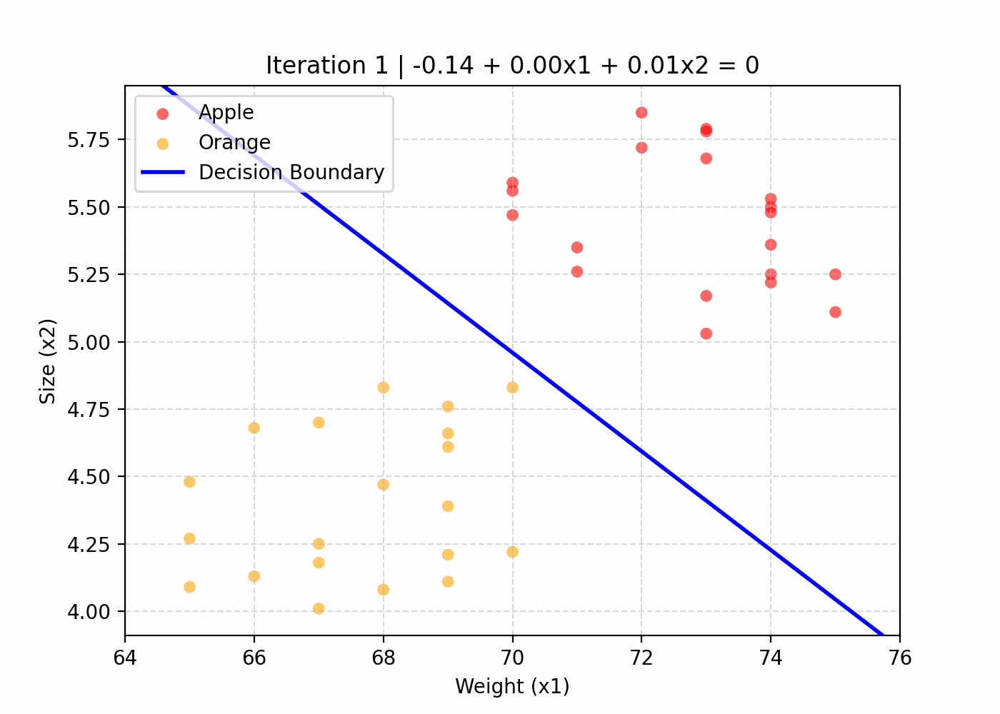

# Logistic Regression - Apples and Oranges Classification

A from-scratch implementation of Logistic Regression using NumPy to classify apples and oranges based on their weight and size.

## Overview

This project explores binary classification using Logistic Regression.

- Dataset: Apples and Oranges
- Features: Weight, Size
- Target: Class (Apple / Orange)
- Implementation: NumPy

## Experiments

### 1. Logistic Regression

- Implemented Logistic Regression from scratch.
- Trained the model using Gradient Descent.
- Visualized the training process through the movement of the decision boundary.
- Recorded and plotted the loss history.

### 2. Logistic Regression with Feature Scaling

- Applied feature scaling to the input features.
- Compared the training behavior with and without feature scaling.
- Visualized the decision boundary during training.

## Results

The training process and decision boundary movements are visualized through animations.

### Without Feature Scaling



### With Feature Scaling



## Project Structure

```text
.
├── data/
│   └── apples_and_oranges.csv
├── results/
│   ├── animations/
│   ├── csv/
│   └── plots/
├── src/
│   ├── logistic_regression.py
│   ├── logistic_regression_feature_scaling.py
│   └── genimg.py
└── README.md
```

## Requirements

```bash
pip install numpy pandas matplotlib
```

## Run

```bash
python src/logistic_regression.py
```

```bash
python src/logistic_regression_feature_scaling.py
```

## Further Reading

Detailed explanations of the mathematical foundations, implementation process, and experimental observations are available on my blog.

**[DeepThinkJo - Machine Learning](https://deepthinkjo.github.io/)**
